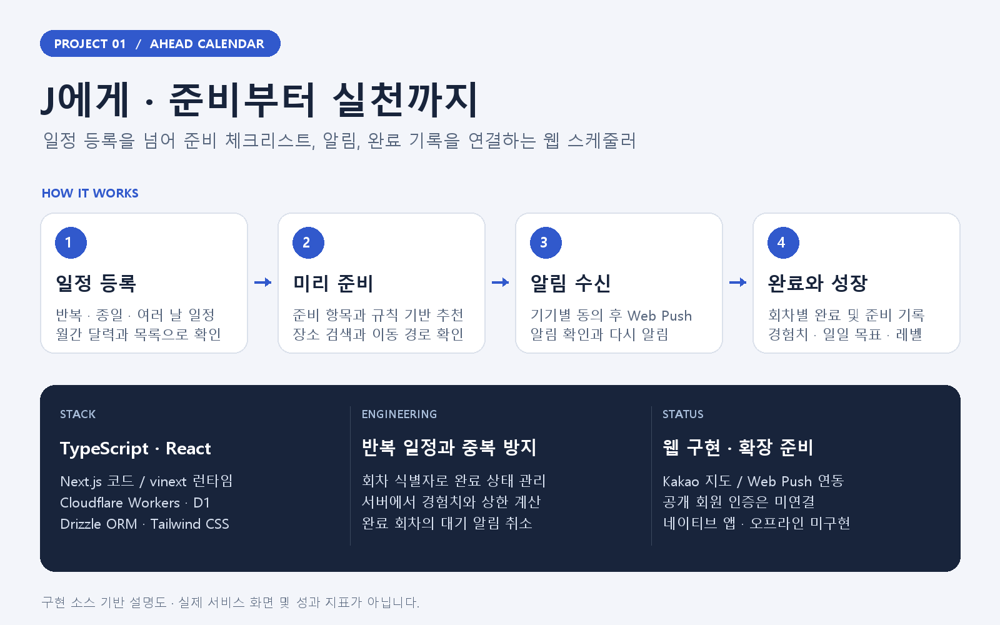
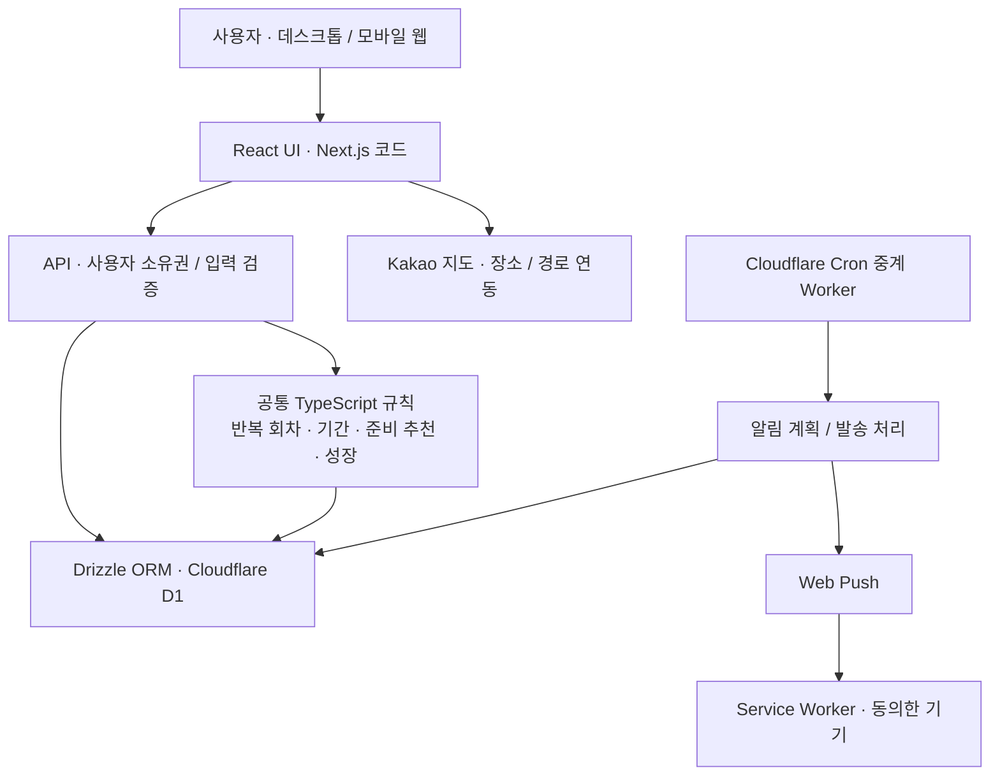

# J에게 (To J) — 준비와 실천을 연결하는 스케줄러

일정을 기록한 뒤에도 **무엇을 준비하고, 언제 확인하고, 실제로 완료했는지** 이어서 관리하는 웹 스케줄러입니다. 달력·준비 체크리스트·Web Push·완료 기록을 하나의 흐름으로 연결합니다.



> 위 이미지는 구현 소스를 바탕으로 만든 설명도입니다. 실제 서비스 스크린샷이나 사용자 성과 지표가 아닙니다.

## 개발 목적

일정의 날짜와 시간만 저장하면 준비해야 할 일과 후속 행동은 별도로 관리해야 합니다. 이 프로젝트는 일정별 준비 항목과 사전 알림을 연결하고, 반복 일정의 각 회차에 완료 상태를 남겨 실행까지 이어지도록 구성했습니다.

## 주요 기능

| 영역 | 구현 내용 |
| --- | --- |
| 일정 관리 | 월간 달력·검색 목록, 날짜·분류 필터, 반복·종일·여러 날 일정 |
| 준비 관리 | 편집 가능한 준비 체크리스트, 규칙 기반 준비 추천, 회차별 준비 완료 |
| 장소와 이동 | Kakao 장소 검색, 지도, 출발지·경유지·이동 경로 확인 |
| 알림 | 기기별 명시적 수신 동의, Web Push, 개별 알림 수정·삭제, 확인·다시 알림 |
| 실천 기록 | 회차별 일정 완료, 일일 목표, 서버에서 계산하는 경험치·레벨·실천일 배지 |
| 일괄 관리 | 일정 일괄 작업과 저장 시 검증 — [설계 문서](docs/BULK_EVENT_MANAGEMENT.md) |

## 시스템 구조



웹 코드는 vinext/Vite를 통해 Cloudflare Workers 환경에서 실행하도록 구성되어 있습니다. 반복 회차·기간·성장 규칙은 화면과 분리한 TypeScript 모듈에 두고, 데이터 저장과 알림 작업은 서버에서 처리합니다.

## 기술 스택

| 구분 | 사용 기술 |
| --- | --- |
| 언어·UI | TypeScript, React, Next.js 코드, Tailwind CSS |
| 빌드·런타임 | vinext, Vite, Cloudflare Workers |
| 데이터 | Cloudflare D1, Drizzle ORM |
| 외부 연동 | Kakao 지도·장소·경로, Web Push, Service Worker |
| 검증 | Node.js 테스트 스크립트, ESLint, TypeScript |

## 설계에서 집중한 부분

- **반복 일정의 회차 구분**: 하나의 일정을 반복해도 각 회차의 준비·완료 상태를 따로 관리합니다.
- **서버 기준의 성장 기록**: 행동 키의 유일 제약과 DB 처리로 중복 경험치를 방지하고 일일 상한을 적용합니다.
- **알림과 완료의 구분**: 알림 확인 자체는 일정 완료가 아닙니다. 완료한 회차의 대기 알림은 취소하고 발송 전에도 유효성을 확인합니다.
- **기기별 알림 동의**: 알림 활성화 여부와 작업 상태를 기기 단위로 관리합니다. 푸시 서비스의 접수와 실제 기기 표시를 구분합니다.

## 로컬 실행과 검증

Node.js `22.13.0` 이상과 pnpm이 필요합니다.

```sh
pnpm install
pnpm dev
```

데이터 기능을 실행하려면 Cloudflare D1의 `DB` 바인딩과 DB 스키마를 준비해야 합니다. 프로젝트의 `.openai/hosting.json` 설정과 로컬 환경을 맞추고, 지도·알림 기능에 필요한 키는 별도로 설정합니다. 저장소 복제만으로 기존 운영 환경이 재현되지는 않습니다.

```sh
pnpm lint
pnpm build
node scripts/test-password-recovery.mjs
```

알림 통합 테스트는 빌드된 Worker와 격리된 D1을 전제로 합니다. 설정·검증 절차는 [알림 스케줄러 문서](docs/NOTIFICATION_SCHEDULER.md)를 참고하세요.

## 현재 상태와 다음 단계

웹 일정·준비·알림·성장 기능을 구현했습니다. 공개 회원 인증은 아직 연결하지 않았으며, 비밀번호 복구는 **미연결 서비스 로직과 가짜 어댑터 테스트** 단계입니다. 네이티브 iOS/Android 앱, 오프라인 동기화, 외부 캘린더 동기화는 미구현입니다.

2026-10-30 업로드 과정에서 비밀번호 복구 테스트 **17개 통과**를 확인했습니다. 이는 전체 기능의 통합 검증이나 기기별 알림 도착 보장을 의미하지 않습니다.

## 문서 찾아보기

- [제품 정의와 핵심 흐름](docs/PRODUCT_SPEC.md)
- [사용자 흐름](docs/USER_FLOW.md)
- [공통 규칙·데이터·모바일 확장 구조](docs/TO_J_ARCHITECTURE.md)
- [준비 추천](docs/PREPARATION_RECOMMENDATIONS.md)
- [알림 스케줄러](docs/NOTIFICATION_SCHEDULER.md)
- [지도 설정](docs/KAKAO_MAPS.md) · [이동 경로](docs/ROUTING.md)
- [계정 인증 설계](docs/ACCOUNT_AUTH_DESIGN.md) · [비밀번호 복구 구현 범위](docs/PASSWORD_RECOVERY.md)

## 라이선스

이 프로젝트의 자체 소스 코드와 문서는 [MIT License](LICENSE)로 공개합니다. 외부 라이브러리·데이터·미디어에는 각 출처의 조건이 적용됩니다. [외부 자료 안내](THIRD_PARTY_NOTICES.md)를 참고하세요.
